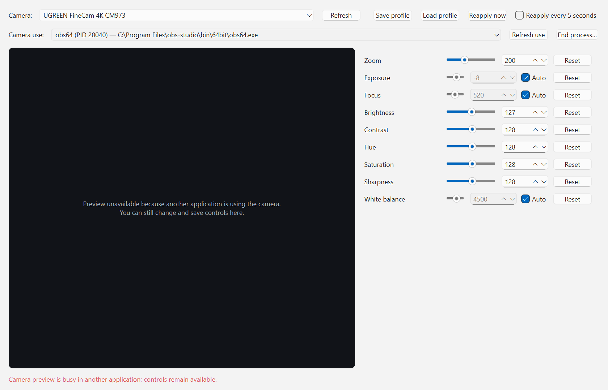

<div align="center">

# Webcam Settings

**A native, cross-platform control panel for the settings your webcam actually exposes.**

Preview the image, tune hardware controls, save profiles, discover which process
has the camera open, and automate everything from a companion CLI.

[](#project-status)
[](https://github.com/tadas-subonis/webcam-settings/actions/workflows/ci.yml)
[](https://en.cppreference.com/w/cpp/20)
[](https://www.qt.io/)
[](https://cmake.org/)
[](#platform-support)
[](#platform-support)
[](#platform-support)
[](LICENSE)

[Features](#features) · [Quick start](#quick-start) · [CLI](#command-line-tool) · [Build](#building-from-source) · [Contributing](#contributing)

</div>



## Why Webcam Settings?

Many webcam applications show the video but hide the camera's hardware controls.
Webcam Settings talks to the native camera API on each operating system, discovers
the controls supported by the connected device, and presents only those controls.
There is no virtual camera, streaming pipeline, account, telemetry, or background
service.

## Features

- Native camera discovery and low-latency preview through Qt Multimedia.
- Dynamic integer, Boolean, menu, button, standard, and vendor control discovery.
- Hardware zoom, exposure, focus, white balance, brightness, contrast, hue,
  saturation, sharpness, and every compatible control reported by the device.
- Windows system video rotation for external USB webcams, including cameras
  without a hardware Roll control.
- Windows extended camera controls for automatic framing, digital crop/window,
  field-of-view presets, stabilization, HDR, focus priority, and supported effects.
- Set-and-read-back verification reports the value the camera actually accepted.
- Manual and automatic modes with immediate application.
- Human-readable `.webcam.json` profiles for backup and repeatable restoration.
- Optional periodic reapply for software that resets camera values.
- Camera-user detection and an explicitly confirmed process-ending action.
- Script-friendly CLI with text and JSON output.
- DPI-correct, frame-backed preview and automated UI screenshots.

## Quick start

### Download a release

Ready-to-run packages are published on the
[GitHub Releases page](https://github.com/tadas-subonis/webcam-settings/releases):

- `WebcamSettings-Windows-x64.zip`
- `WebcamSettings-Linux-x64.tar.gz`
- `WebcamSettings-macOS.zip`
- `SHA256SUMS.txt` for download verification

Extract the archive for your platform and launch `webcam-settings`. The Windows
package includes the required Qt runtime, so it can be run without installing Qt.

### Run the application

Run the desktop application, select a camera, and move a supported control. Changes
are applied directly to the physical webcam and are immediately visible to other
applications using it.

```powershell
# Windows packaged build
.\dist\bin\webcam-settings.exe

# Inspect the same camera from a terminal
.\dist\bin\webcam-settings-cli.exe controls --device UGREEN
```

If another program owns the video stream, the preview switches to a clear busy
state while hardware controls remain available. The **Camera use** row identifies
the process where the operating system permits it. **End process…** always asks
for confirmation because terminating an application can discard unsaved work.

> [!TIP]
> For the UGREEN FineCam 4K CM973, zoom values around `150`–`200` are a useful
> starting point when the default field of view captures too much of the room.

## Platform support

| Platform | Native backend | Hardware controls | Camera-user detection |
|:--|:--|:--|:--|
| Windows 10/11 | DirectShow + Media Foundation fallback | Standard controls plus supported `KSPROPERTYSETID_ExtendedCameraControl` features | Camera privacy activity plus the running process list |
| Linux | Video4Linux2 + PipeWire device bridge | Full `VIDIOC_QUERY_EXT_CTRL` enumeration, including vendor/menu/Boolean controls | Processes holding the selected `/dev/video*` device |
| macOS | AVFoundation through Qt | Camera discovery and preview; physical UVC settings are hidden | Not exposed by AVFoundation |

Unsupported hardware controls are hidden rather than simulated. macOS intentionally
offers preview without physical controls because its AVFoundation API does not expose
the zoom, focus, or general vendor UVC settings available on iOS. On Windows, privacy activity identifies webcam capability
use but does not reveal which physical camera was opened on a multi-camera system.

Windows extended features depend on both the Windows version and camera driver.
Digital-window crop controls only work while the driver has an active stream, as
required by the Windows camera API. The Linux PipeWire bridge maps PipeWire camera
nodes back to their V4L2 device when `pw-dump` is available; hardware changes still
use V4L2 because PipeWire does not define a portable UVC-settings protocol.

### Rotate an external USB webcam on Windows

Select the camera and use **Video rotation**: **No rotation**, **Right 90°**,
**180°**, or **Left 90°**. This saves a machine-wide orientation override in the
Windows camera pipeline, so compatible applications such as Google Meet can use
the corrected video after reopening the camera. Windows may show an administrator
prompt; cancelling it restores the dropdown to the saved value. Keep
`webcam-settings-cli.exe` alongside the desktop application for this operation.

After changing rotation, turn the camera off and on in other apps. If necessary,
close camera apps and reconnect the webcam so Windows reloads its configuration.
Rotation is also saved in webcam profiles. The CLI can set it from an elevated
terminal with `webcam-settings-cli rotate 90 --device UGREEN` (clockwise degrees).

This uses Windows' documented
[`FSSensorOrientation` camera-pipeline correction](https://learn.microsoft.com/en-us/windows-hardware/drivers/stream/camera-device-orientation),
separately from the per-user defaults in Windows Settings. It does not rotate just
the app's preview. Applications that bypass the Windows camera pipeline may not
honor the override. Nonzero rotation filters out compressed capture formats such
as MJPEG and H.264; Windows can expose decoded formats instead. **No rotation**
clears the extra pipeline rotation; it does not change a separate rotation default
configured in Windows Settings.

## Command-line tool

The CLI selects an UGREEN camera by default when one is connected. Pass
`--device <name-or-id-substring>` to choose a different device and `--json` where
machine-readable output is needed.

| Task | Command |
|:--|:--|
| List cameras | `webcam-settings-cli devices` |
| List formats | `webcam-settings-cli formats --device UGREEN` |
| Inspect controls | `webcam-settings-cli controls --device UGREEN` |
| Find camera users | `webcam-settings-cli users --device UGREEN` |
| Change controls | `webcam-settings-cli set zoom=175 brightness=128 --device UGREEN` |
| Set Boolean/menu controls | `webcam-settings-cli set focus-auto=on exposure-auto=1 --device UGREEN` |
| Enable automatic modes | `webcam-settings-cli set focus=auto exposure=auto --device UGREEN` |
| Save a profile | `webcam-settings-cli save before.webcam.json --device UGREEN` |
| Restore a profile | `webcam-settings-cli restore before.webcam.json --device UGREEN` |
| End a process | `webcam-settings-cli terminate 1234 --yes` |

Control IDs come from `controls`; unknown Linux controls use stable IDs such as
`v4l2:0x009a0920`. Boolean values accept `on`/`off`, and menu values accept either
their numeric value or displayed label. Values are validated, clamped, aligned,
written, and read back from the device. `restore` returns a nonzero exit code if
any control fails. Process
termination requires `--yes`; without it, the CLI refuses the operation.

<details>
<summary><strong>Example JSON output</strong></summary>

```json
{
  "device": "UGREEN FineCam 4K CM973",
  "users": [
    {
      "pid": 20040,
      "name": "obs64",
      "executable": "C:\\Program Files\\obs-studio\\bin\\64bit\\obs64.exe",
      "detail": "Windows camera privacy activity"
    }
  ]
}
```

</details>

## Building from source

### Requirements

- CMake 3.24 or newer
- A C++20 compiler
- Qt 6.5 or newer with Core, Gui, Widgets, and Multimedia
- Windows: Visual Studio 2022 with the Desktop C++ workload
- Linux: V4L2 headers, normally supplied by `linux-libc-dev`
- macOS: Xcode command-line tools

Configure Qt through `CMAKE_PREFIX_PATH` or `Qt6_DIR`, then build and test:

```sh
cmake -S . -B build -DCMAKE_PREFIX_PATH=/path/to/Qt/6.x/compiler
cmake --build build --config Release
ctest --test-dir build -C Release --output-on-failure
cmake --install build --config Release --prefix dist
```

<details>
<summary><strong>Windows: install a project-local Qt SDK</strong></summary>

```powershell
py -m pip install --user aqtinstall
py -m aqt install-qt windows desktop 6.8.3 win64_msvc2022_64 `
  -O .deps/Qt -m qtmultimedia

cmake -S . -B build -G "Visual Studio 17 2022" -A x64 `
  -DCMAKE_PREFIX_PATH="$PWD/.deps/Qt/6.8.3/msvc2022_64"
cmake --build build --config Release
ctest --test-dir build -C Release --output-on-failure
```

</details>

On macOS, the generated application bundle includes the camera permission text.
Allow camera access when prompted on first launch.

## Automated screenshots

The GUI can capture itself after camera discovery and exit, which is useful for UI
regression checks:

```powershell
webcam-settings --screenshot screenshot.png
```

## Project status

Webcam Settings is under active development. The core GUI, native control backends,
profiles, camera-user inspection, CLI, packaging, and automated tests are working.
Bug reports, device compatibility findings, documentation improvements, and focused
pull requests are welcome.

Version tags matching `v*` are built automatically on Windows, Linux, and macOS.
After all packages succeed, the release workflow publishes the archives and their
SHA-256 checksums to GitHub Releases.

## Contributing

1. Fork the repository and create a focused branch.
2. Keep platform-specific behavior behind the existing backend interfaces.
3. Build the project and run `ctest --test-dir build -C Release --output-on-failure`.
4. Describe the camera model and operating system used for hardware testing.
5. Open a pull request with a concise explanation and screenshots for UI changes.

Please never include private camera frames, machine-specific paths, or saved profiles
containing sensitive data in an issue or pull request.

## Upstream and acknowledgements

This project was inspired by Patrick Belanger's MIT-licensed
[SeriousWebcamSettings](https://github.com/PatBQc/SeriousWebcamSettings). It brings
similar ideas—supported webcam controls, profiles, and periodic reapplication—to
an independent cross-platform C++/Qt implementation. No AForge, WPF, C#, artwork,
or binary code from the reference project is included; see [NOTICE.md](NOTICE.md).

Webcamoid was reviewed as prior art for capability coverage. No Webcamoid source,
algorithms, assets, or plugin architecture were copied. The dynamic descriptors and
native backends here are an independent implementation based on the public Windows
SDK, Linux V4L2 API, Qt API, and PipeWire node metadata.

## License

Distributed under the [MIT License](LICENSE).
